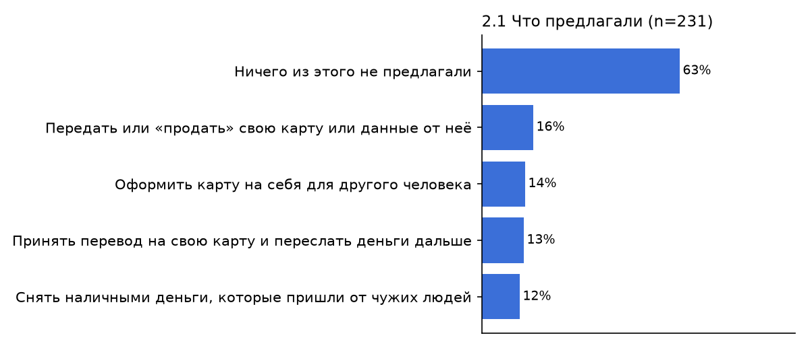
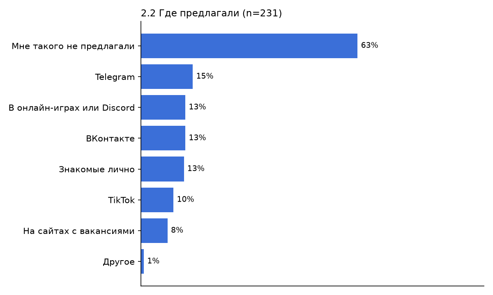
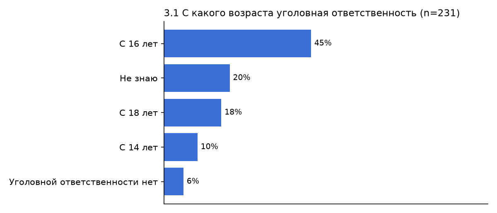
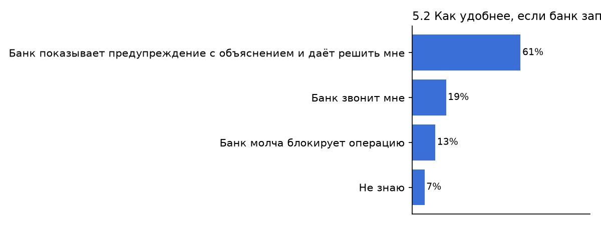
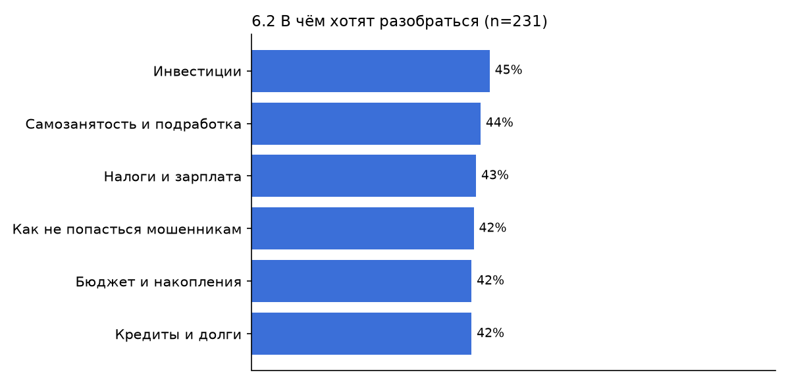

# Результаты опроса по гипотезам (авто-сводка)

- всего анкет: **250**
- в анализе (18–22, подтвердили 18+): **231**
- доля 18–19 лет: **54%** (цель ТЗ — не меньше 30%)

> Сгенерировано скриптом `docs/research/scripts/survey_summary.py`. Выводы и цитаты из интервью дописываем вручную в `survey_results.md`.

## H1. Молодёжь массово получает предложения «подработки» через карту — ПОДТВЕРЖДЕНА

- Получали хотя бы одно предложение: **37%** (85 из 231; 95% ДИ 31%–43%) · порог ≥ 30%
- По возрасту: 18 — 38% (n=60); 19 — 40% (n=65); 20 — 32% (n=44); 21 — 27% (n=33); 22 — 45% (n=29)

| Ответ | Кол-во | Доля |
|---|---|---|
| Ничего из этого не предлагали | 146 | 63% |
| Передать или «продать» свою карту или данные от неё | 38 | 16% |
| Оформить карту на себя для другого человека | 32 | 14% |
| Принять перевод на свою карту и переслать деньги дальше | 31 | 13% |
| Снять наличными деньги, которые пришли от чужих людей | 28 | 12% |

Где предлагали (2.2):

| Ответ | Кол-во | Доля |
|---|---|---|
| Мне такого не предлагали | 146 | 63% |
| Telegram | 35 | 15% |
| ВКонтакте | 30 | 13% |
| В онлайн-играх или Discord | 30 | 13% |
| Знакомые лично | 29 | 13% |
| TikTok | 22 | 10% |
| На сайтах с вакансиями | 18 | 8% |
| Другое | 2 | 1% |

## H2. Большинство не знает, что делать с чужими деньгами — НЕ ПОДТВЕРЖДЕНА

- Выбрали неверное действие: **29%** (67 из 231; 95% ДИ 24%–35%) · порог ≥ 50%
- Правильный ответ (позвонить в банк): **51%** (118 из 231; 95% ДИ 45%–57%)

| Ответ | Кол-во | Доля |
|---|---|---|
| Позвоню в свой банк и сообщу о переводе | 118 | 51% |
| Спрошу совета у родителей или друзей | 31 | 13% |
| Верну отправителю сам тем же способом | 31 | 13% |
| Ничего не буду делать и подожду | 21 | 9% |
| Переведу на номер, который он прислал | 15 | 6% |
| Не знаю | 15 | 6% |

## H3. Большинство не знает реальных последствий — ПОДТВЕРЖДЕНА

- Ответили верно меньше чем на 2 вопроса из 3: **56%** (129 из 231; 95% ДИ 49%–62%) · порог ≥ 50%
- Верно на 3.1 (возраст ответственности 16): **45%** (105 из 231; 95% ДИ 39%–52%)
- Верно на 3.2 (блокировки + база ЦБ): **40%** (93 из 231; 95% ДИ 34%–47%)
- Верно на 3.3 (отвечает владелец): **48%** (112 из 231; 95% ДИ 42%–55%)

Ответы на 3.1:

| Ответ | Кол-во | Доля |
|---|---|---|
| С 16 лет | 105 | 45% |
| Не знаю | 47 | 20% |
| С 18 лет | 41 | 18% |
| С 14 лет | 24 | 10% |
| Уголовной ответственности нет | 14 | 6% |

## H4. Предупреждение с объяснением лучше молчаливой блокировки — ПОДТВЕРЖДЕНА

- Выбрали предупреждение с объяснением: **61%** (141 из 231; 95% ДИ 55%–67%) · порог ≥ 60%
- Понятность экрана перехвата: **4.1 из 5** (n=231) · порог ≥ 4
- Предупреждение остановило бы («да» и «скорее да»): **66%** (152 из 231; 95% ДИ 59%–72%)
- Сталкивались с блокировкой без объяснения: **18%** (42 из 231; 95% ДИ 14%–24%)

| Ответ | Кол-во | Доля |
|---|---|---|
| Банк показывает предупреждение с объяснением и даёт решить мне | 141 | 61% |
| Банк звонит мне | 44 | 19% |
| Банк молча блокирует операцию | 30 | 13% |
| Не знаю | 16 | 7% |

## H5. Молодёжь готова учиться финграмотности в банковском приложении — ПОДТВЕРЖДЕНА

- «Да» и «скорее да»: **45%** (105 из 231; 95% ДИ 39%–52%) · порог ≥ 40%

В чём хотят разобраться (6.2):

| Ответ | Кол-во | Доля |
|---|---|---|
| Инвестиции | 105 | 45% |
| Самозанятость и подработка | 101 | 44% |
| Налоги и зарплата | 99 | 43% |
| Как не попасться мошенникам | 98 | 42% |
| Бюджет и накопления | 97 | 42% |
| Кредиты и долги | 97 | 42% |

## Графики

